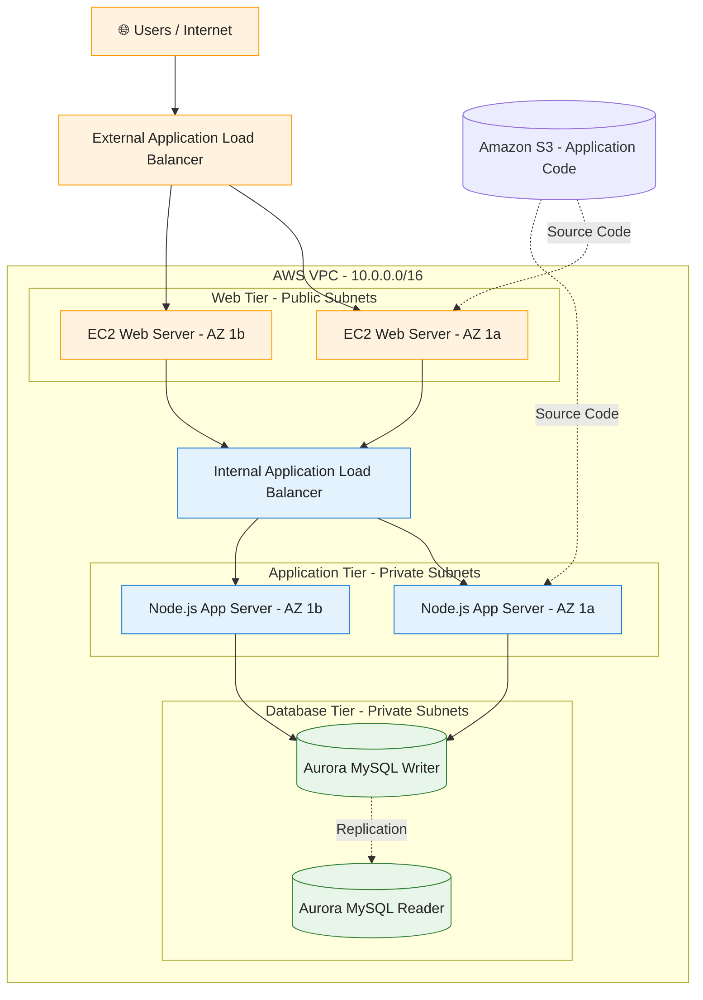

# 3-Tier-Project


<div align="center">

# ☁️ AWS Three-Tier Web Application

### Highly Available • Secure • Scalable • Fault-Tolerant

**End-to-End AWS Cloud Engineering & DevOps Project**

<p>


</p>

**Designed, Deployed & Documented by Vishal Patil**

[](https://lnkd.in/p/dqwXgC4W)

[](https://github.com/VishalPatil-DevOps-AWS)
[](https://www.linkedin.com/in/vishalpatil-devops-aws/)

</div>

---

## 📖 Project Overview

This project demonstrates the deployment of a **highly available, secure, scalable, and fault-tolerant three-tier web application on AWS**.

The architecture separates the application into three independent layers:

- **Presentation Tier:** React frontend served through Nginx.
- **Application Tier:** Node.js backend managed using PM2.
- **Database Tier:** Amazon Aurora MySQL-compatible database.

The infrastructure is deployed inside a custom **Amazon VPC**, distributed across **two Availability Zones**, and uses **Application Load Balancers, Auto Scaling Groups, NAT Gateways, IAM Roles, and Security Groups**.

### 🎯 Project Objectives

- Build a production-style three-tier AWS architecture.
- Implement high availability using Multi-AZ deployment.
- Separate public and private infrastructure.
- Configure secure communication between application tiers.
- Distribute traffic using Application Load Balancers.
- Implement EC2 Auto Scaling.
- Deploy a managed Aurora MySQL database.
- Improve fault tolerance and infrastructure reliability.
- Gain hands-on AWS Cloud Engineering experience.

---

## 🏗️ AWS Architecture



### 🔄 Application Traffic Flow

```text
Users / Browser
       |
       v
Internet-Facing Application Load Balancer
       |
       v
Web Tier (Nginx + React)
       |
       v
Internal Application Load Balancer
       |
       v
Application Tier (Node.js + PM2)
       |
       v
Amazon Aurora MySQL Database
```

---

## 🛠️ Technology Stack

<div align="center">


</div>

---

## ☁️ AWS Services Used

| AWS Service | Purpose |
|---|---|
| Amazon VPC | Isolated virtual network |
| Amazon EC2 | Web and application servers |
| Amazon Aurora MySQL | Managed relational database |
| Application Load Balancer | Distributes application traffic |
| EC2 Auto Scaling | Maintains server capacity |
| Amazon S3 | Application source code storage |
| AWS IAM | Secure permissions and instance roles |
| NAT Gateway | Outbound connectivity for private instances |
| Internet Gateway | Public internet connectivity |
| Security Groups | Network traffic filtering |
| Route Tables | Network routing configuration |
| Amazon Machine Images | Reusable EC2 images |
| Launch Templates | EC2 configuration templates |
| Target Groups | Load balancer routing and health checks |

---

## 🌐 VPC & Network Design

**AWS Region:** Asia Pacific (Mumbai) `ap-south-1`

**VPC CIDR:** `10.0.0.0/16`

**Availability Zones:** `ap-south-1a`, `ap-south-1b`

| Subnet | Availability Zone | CIDR | Type |
|---|---|---|---|
| Web-Tier-Subnet-1 | ap-south-1a | 10.0.1.0/24 | Public |
| App-Tier-Subnet-1 | ap-south-1a | 10.0.2.0/24 | Private |
| DB-Tier-Subnet-1 | ap-south-1a | 10.0.3.0/24 | Private |
| Web-Tier-Subnet-2 | ap-south-1b | 10.0.4.0/24 | Public |
| App-Tier-Subnet-2 | ap-south-1b | 10.0.5.0/24 | Private |
| DB-Tier-Subnet-2 | ap-south-1b | 10.0.6.0/24 | Private |

### Network Components

**Internet Gateway**
- Provides internet connectivity for public subnets.

**NAT Gateways**
- Allow private application instances to access external resources.
- Two NAT Gateways are used across Availability Zones.

**Route Tables**
- Public subnets route internet-bound traffic through the Internet Gateway.
- Private application subnets route outbound internet traffic through NAT Gateways.
- Database subnets remain isolated from direct internet access.

---

## 🔐 Security Group Configuration

| Security Group | Port | Allowed Source |
|---|---|---|
| External-Load-Balancer-SG | 80 | 0.0.0.0/0 |
| Web-Tier-SG | 80 | External-Load-Balancer-SG |
| Internal-Load-Balancer-SG | 80 | Web-Tier-SG |
| App-Tier-SG | 4000 | Internal-Load-Balancer-SG |
| DB-Tier-SG | 3306 | App-Tier-SG |

### Security Principles

- Application servers are deployed in private subnets.
- Database instances are deployed in private database subnets.
- Only authorized security groups can communicate between tiers.
- IAM roles provide AWS service permissions without hardcoding access keys.
- The database is not directly accessible from the internet.

---

## 🚀 Step-by-Step Deployment

### Phase 1: Network Foundation

**Step 01 — Create VPC and Subnets**

- Create custom VPC.
- Configure six subnets.
- Distribute subnets across two Availability Zones.

**Step 02 — Configure Networking**

- Create Internet Gateway.
- Configure NAT Gateways.
- Create route tables.
- Associate subnets with appropriate route tables.

**Step 03 — Configure Security Groups**

- Create external ALB security group.
- Create web tier security group.
- Create internal ALB security group.
- Create application tier security group.
- Create database security group.

### Phase 2: Database & Access Management

**Step 04 — Create Aurora MySQL Database**

- Create database subnet group.
- Configure Aurora MySQL cluster.
- Deploy database instances across Availability Zones.
- Configure database connectivity.

**Step 05 — Configure IAM Role**

- Create EC2 IAM role.
- Configure required S3 access.
- Enable permissions for Systems Manager access.

**Step 06 — Configure Amazon S3**

- Create S3 bucket.
- Upload frontend application code.
- Upload backend application code.

### Phase 3: Application Deployment

**Step 07 — Configure Application Server**

- Launch EC2 application server.
- Install Node.js and npm.
- Download application source code.
- Install dependencies.
- Configure database connection.
- Start backend using PM2.

**Step 08 — Create Application AMI**

- Create reusable image of configured application server.

**Step 09 — Configure Internal Load Balancer**

- Create application target group.
- Configure health checks.
- Create application launch template.
- Deploy internal Application Load Balancer.

**Step 10 — Configure Web Server**

- Launch EC2 web server.
- Install Nginx.
- Download React frontend code.
- Build the frontend application.
- Configure Nginx.
- Connect web tier to internal ALB.

**Step 11 — Create Web Server AMI**

- Create reusable image of configured web server.

**Step 12 — Configure External Load Balancer**

- Create web tier target group.
- Configure web launch template.
- Deploy internet-facing Application Load Balancer.

### Phase 4: High Availability & Verification

**Step 13 — Configure Auto Scaling Groups**

- Create application tier Auto Scaling Group.
- Create web tier Auto Scaling Group.
- Configure desired capacity and health checks.

**Step 14 — Access the Application**

- Open the external ALB DNS endpoint.
- Verify frontend accessibility.
- Verify backend connectivity.
- Test database operations.
- Check load balancer target health.

**Step 15 — Clean Up Resources**

- Delete unused EC2 instances and Auto Scaling Groups.
- Delete Application Load Balancers.
- Delete NAT Gateways.
- Delete Aurora database resources.
- Remove remaining resources when no longer needed.

---

## 🧪 Application Testing

### Check Backend Health

```bash
curl http://localhost:4000/health
```

Expected response:

```text
This is the health check
```

### Verify Nginx Configuration

```bash
sudo nginx -t
```

### Check Nginx Service

```bash
sudo systemctl status nginx
```

### Verify PM2 Processes

```bash
pm2 list
```

### View Application Logs

```bash
pm2 logs
```

### Verify Load Balancer

1. Open AWS EC2 Console.
2. Navigate to Target Groups.
3. Select the appropriate target group.
4. Verify registered targets are healthy.
5. Access the external ALB DNS name.

---

## 📈 High Availability & Scalability

### Multi-AZ Deployment

The architecture distributes web, application, and database resources across two Availability Zones to improve resilience.

### Application Load Balancing

- External ALB distributes traffic to web servers.
- Internal ALB distributes backend requests to application servers.
- Health checks identify unhealthy targets.

### Auto Scaling

Auto Scaling Groups maintain configured EC2 capacity and can replace unhealthy instances.

### Database Availability

Amazon Aurora MySQL provides a writer instance and a reader instance across Availability Zones.

---

## 🔧 Troubleshooting Guide

| Issue | Troubleshooting |
|---|---|
| 403 Forbidden | Verify Nginx root path and file permissions |
| 500 Internal Server Error | Check Nginx configuration and logs |
| 502 Bad Gateway | Check backend connectivity and target health |
| 503 Service Unavailable | Verify healthy registered ALB targets |
| Backend not responding | Verify Node.js, PM2 and port 4000 |
| Database connection failed | Check RDS endpoint, credentials and SG rules |
| React frontend not loading | Verify build directory and Nginx configuration |
| Auto Scaling issue | Review launch templates and instance health |

---

## 🛡️ Production Improvement Opportunities

Potential enhancements include:

- HTTPS using AWS Certificate Manager.
- AWS WAF for web application protection.
- CloudWatch monitoring and alarms.
- AWS Secrets Manager for database credentials.
- CI/CD automation using GitHub Actions.
- Infrastructure as Code using Terraform.
- Automated database backups.
- Centralized logging and monitoring.
- More restrictive IAM policies.

---

## 💰 AWS Cost Awareness

> ⚠️ **Important:** This project uses AWS resources that may incur charges, including EC2 instances, NAT Gateways, Application Load Balancers, and Amazon Aurora.

After completing the project:

- Delete unnecessary resources.
- Review the AWS Billing Dashboard.
- Configure AWS Budgets for cost monitoring.
- Check for remaining billable resources.

---

## 📚 Complete Project Documentation

<div align="center">

### 📖 AWS Three-Tier Architecture — Implementation Guide

**15 Guided Steps | 3 Application Tiers | 2 Availability Zones**


<br>

[](https://lnkd.in/p/dqwXgC4W)

<br>

**🔗 Project Documentation Link:**

https://lnkd.in/p/dqwXgC4W

</div>

---

## 📚 References

- [AWS Official Documentation](https://docs.aws.amazon.com/)
- [Amazon VPC Documentation](https://docs.aws.amazon.com/vpc/)
- [Amazon EC2 Documentation](https://docs.aws.amazon.com/ec2/)
- [Amazon Aurora Documentation](https://docs.aws.amazon.com/AmazonRDS/latest/AuroraUserGuide/)
- [Elastic Load Balancing Documentation](https://docs.aws.amazon.com/elasticloadbalancing/)
- [AWS Auto Scaling Documentation](https://docs.aws.amazon.com/autoscaling/)
- [Reference Application Source](https://github.com/Rutuja-Naik07/Project-Three-Tier-Architecture-on-AWS)

---

## 👨‍💻 Author

<div align="center">

### Vishal Patil

**AWS Cloud & DevOps Enthusiast**

*Learning • Building • Deploying • Documenting*

<br>

[](https://github.com/VishalPatil-DevOps-AWS)

[](https://www.linkedin.com/in/vishalpatil-devops-aws/)

<br>

**#vishalcloudjourney**

---

### ☁️ Building Cloud Skills, One Project at a Time

**AWS | Cloud Computing | DevOps | Linux | Networking**

**October 2026**

</div>
